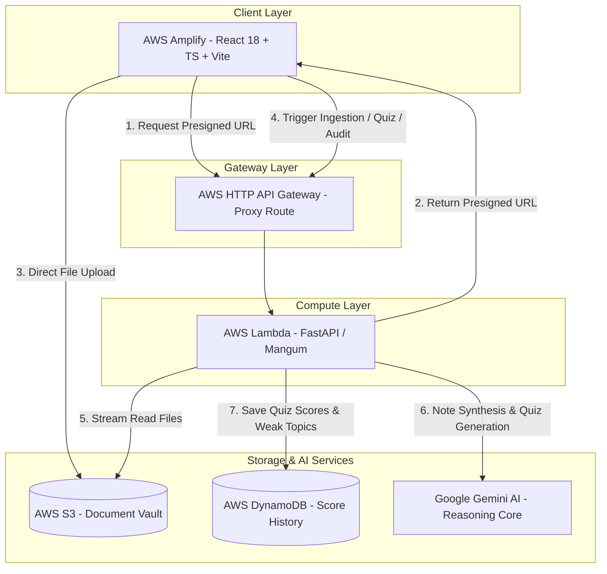

# PanicDeck ⚡

> **Autonomous AI-Powered Exam Preparation Agent & Syllabus Audit Engine**  
> *Transform scattered lecture slides, messy PDFs, and past exams into structured notes, high-yield diagnostic drills, and syllabus gap audits.*

---

## 📖 Overview

**PanicDeck** is a high-yield study companion built for time-pressured university students facing challenging examinations. Rather than manually organizing disjointed lecture dossiers, syllabus requirements, and historical papers, PanicDeck ingests raw materials into an autonomous AI pipeline that:

1. **Synthesizes & Structures**: Parses lecture slides, notes, and textbook excerpts into rigorous, topic-by-topic study dossiers.
2. **Audits Syllabus Blindspots**: Cross-references official course syllabus specifications against uploaded material to flag missing proofs, thin sections, and mandatory exam criteria.
3. **Weighting by Past Papers**: Analyzes 5–10 years of historical exam papers to calculate the statistical frequency and weighting of topics.
4. **Active Recall Diagnostics**: Generates targeted, exam-grade multiple choice recall drills weighted toward high-frequency exam topics.
5. **Pinpoints Weak Topics**: Continuously tracks recall quiz performance and logs historical accuracy to isolate exact conceptual vulnerabilities.

---

## 🏛️ Architecture & Tech Stack

### **Tech Stack Breakdown**

| Layer | Technology | Role |
| :--- | :--- | :--- |
| **Frontend** | React 18, TypeScript, Vite | Dark glassmorphism archival dashboard UI |
| **Hosting & CI/CD** | AWS Amplify | Continuous deployment & global edge hosting |
| **API Gateway** | AWS HTTP API Gateway | Low-latency greedy proxy routing (`/{proxy+}`) with CORS |
| **Serverless Compute** | AWS Lambda (Python 3.12) | FastAPI application running on Mangum ASGI adapter |
| **Object Storage** | AWS S3 (`examprep-test-7k2q9x`) | Presigned direct uploads and raw document storage |
| **NoSQL Database** | AWS DynamoDB (`PanicDeck-Scores`) | User quiz history, topic accuracy breakdown, & weak spots |
| **AI Intelligence** | Google Gemini API | Document OCR, syllabus cross-referencing, and recall drills |

---

## ✨ Key Features

### 1. 📂 Document Ingestion & Topic Synthesis
* Supports PDF lecture slides, handwritten notes, and text transcripts.
* Ingests files directly to S3 via secure, short-lived presigned URLs.
* Generates structured markdown summaries complete with definitions, equations, theorems, and examination heuristics.

### 2. 🔍 Syllabus Coverage Audit
* Upload your official course syllabus PDF or syllabus specifications.
* Cross-references every syllabus mandate against uploaded notes.
* Flags blindspots and enables **One-Click Auto-Synthesis** to automatically draft missing derivations and add them directly to your study topics.

### 3. 📊 Past-Paper Frequency Weighting
* Ingest multiple years of past exam papers.
* Identifies recurring questions and ranks topics by historical frequency (`High`, `Medium`, `Low`).
* Dynamically influences question generation to prioritize what exam committees actually test.

### 4. 🧠 Active Recall Diagnostic Drills
* Generates challenging, 4-option multiple-choice recall drills tailored to active topics.
* Instant grading with real-time feedback on wrong answers and detailed rationales.

### 5. 📈 Weak Topic Heatmap & Score Tracking
* Isolates error rates across topics to rank weaknesses by severity (`High`, `Medium`, `Low`).
* Persists quiz score records and topic-by-topic error history in DynamoDB.
